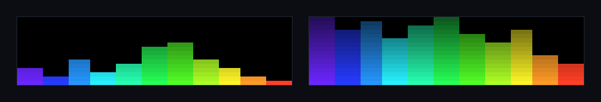

# pypixel-eq

[](https://github.com/kidelo/pypixel_eq/actions/workflows/ci.yml)


Audio-reactive equalizer for an [iPixel Color](https://ipixel.com.tw/) LED
panel. It captures the system audio output, analyzes it into **11 log-spaced
frequency bands** (20 Hz – 12 kHz) and streams the result to the panel over
BLE — either as band levels for the panel's own visualizer, or as rendered
64×16 frames.



## Features

- 11 log-spaced bands with attack/release smoothing, levels 0..15.
- **Adaptive max** (auto-gain): the recent peak normalizes all bars together,
  so quiet passages stay visible and loud ones do not pin at the top.
- Two transports: `rhythm` (16 bytes/frame, panel draws the bars) and `png`
  (rendered frame, true full replace, stable 10 fps).
- **Non-blocking writer**: `update()` hands the frame to a background thread
  (newest wins), so BLE latency never stalls the audio analysis.
- Reconnects automatically with backoff; the GUI and analysis keep running.
- Live tkinter view with a 64×16 panel emulation, and a `--test` mode that
  needs no audio device and no hardware.

## Transports

| Transport | What is sent | Notes |
|---|---|---|
| `rhythm` (default) | Only the 11 band levels (0..15) | The panel's **native** music visualizer draws the bars itself. ~16 bytes/update, ~110-byte wire frame. |
| `png` | A rendered 64×16 static-image frame | A TRUE full replace of the panel each update; stable up to 10 fps. |

Both transports are **fire-and-forget** (no panel protocol ACK is awaited):
the panel does not reliably ACK these writes, and waiting for one stalls the
frame loop. `--queue N` sets how many frames may wait for the radio
(default 1; the oldest unsent frame is dropped).

## Install

### Prerequisites

- Python ≥ 3.10 and [`uv`](https://docs.astral.sh/uv/)
- A Bluetooth LE adapter and an iPixel Color panel that is **not** connected
  to the phone app while this runs.
- Audio capture:
  - **Windows** — WASAPI loopback of the default output (`pyaudiowpatch`).
  - **Linux** — the PulseAudio/PipeWire `<sink>.monitor` source.

### Setup

```bash
git clone --recurse-submodules https://github.com/kidelo/pypixel_eq.git
cd pypixel_eq
uv sync --extra dev --extra audio
```

The BLE library is vendored as a **git submodule** at a pinned commit of
[kidelo/pypixelcolor-ext](https://github.com/kidelo/pypixelcolor-ext), a fork
of [pypixelcolor](https://github.com/lucagoc/pypixelcolor) that carries
hardware-verified fixes (fire-and-forget `set_fun_mode`, `write_with_response`,
bounded pre-connect scan). It is consumed as a **path dependency**, so `uv`
builds and installs the exact pinned commit — not a PyPI release.

Forgot `--recurse-submodules`? Run:

```bash
git submodule update --init --recursive
uv sync --extra dev --extra audio
```

## Quick start

```bash
# Live view only: bands + panel emulation, system audio, no hardware.
uv run python -m pypixel_eq --gui

# Stream to a panel (rhythm transport, the default).
uv run python -m pypixel_eq -a <MAC>

# Rendered frames instead (true full replace, held at 10 fps).
uv run python -m pypixel_eq -a <MAC> --transport png

# Higher refresh rate of the native visualizer.
uv run python -m pypixel_eq -a <MAC> --overlap 1

# No audio device: synthetic 11-band stimulus.
uv run python -m pypixel_eq --test --gui
```

`--test` is the fastest way to check the BLE path without playing audio; it
feeds a synthetic sweep through the same render/send pipeline.

## How it works

```
system audio ─► WASAPI/monitor ─► Hann-windowed FFT (2048) ─► 11 bands
      ─► dB ─► levels 0..15 (attack/release, auto-gain)
      ─► render (png only) ─► payload ─► background writer ─► BLE
```

### Panel update rate (`--overlap` 0-2, default 0)

The analysis loop re-analyzes a rolling 2048-sample window every
`FRAME/(1+overlap)` samples, so each overlap level adds a full analysis pass
per second of audio:

| `--overlap` | 0 | 1 | 2 |
|---|---|---|---|
| hop (samples) | 2048 | 1024 | 683 |
| panel rate | 23.4 Hz | 46.9 Hz | 70.3 Hz |

Frequency resolution is preserved (the same 2048-sample FFT every frame), so
the bass bands keep their bins at every level. The range is capped at 2: on
the panel, higher rates overload it and the high bands get damped or become
invisible. `rhythm` is not rate-capped: it sends every analysis frame and runs
at the link rate. The `png` image path is the limited one (stable up to
10 fps). `--fps` still thins the writes below the resulting rate.

### Measured link cost

Write duration per frame on a 64×16 panel with MTU 517, measured with `--test`
and the background writer:

| transport | write | panel rate |
|---|---|---|
| `png`, with response | ~86-91 ms | 10 fps (held; ~11.5 fps flickers) |
| `rhythm`, with response | ~42-47 ms | ~22 fps |
| `png`, `--no-response` | ~2-10 ms | link-limited, not panel-safe |

The response is a link-layer round trip per chunk, not a protocol ACK. With
`--no-response` the panel can be fed at the full analysis rate; the trade-off
is that the transport no longer sees a per-chunk delivery confirmation, so
treat it as an experiment until it has proven stable over long runs.

The image path has a different limit: above ~10 fps the panel drops or
redraws frames (visible flicker) no matter how fast the writes are, so the
`png` transport holds 10 fps unless `--fps` says otherwise.

### Adaptive max (auto-gain, on by default)

The bars are normalized to the **recent maximum over all bands**: the max of
the loudest band's level over the last `--gain-window` seconds (default 2) is
mapped to level 15. Loud passages stop pinning at the top, quiet passages
grow, and the loudest band of the window sits at the top while every other bar
stays proportionally scaled to it — a quiet band does NOT grow to its own peak
(which would flatten the relative balance). The floor stays at -70 dB (a band
can fall back to 0); only the ceiling adapts. A silent signal never gets
full-height bars (the span is floored at 10 dB).

```bash
# default: auto-gain on
uv run python -m pypixel_eq --gui

# fixed -70/-20 dB span (the old behavior), longer history:
uv run python -m pypixel_eq --no-auto-gain --gain-window 10
```

## Flags

| Flag | Meaning |
|---|---|
| `-a, --address <MAC>` | BLE address; without it nothing is sent to the panel. |
| `--gui` | Live tkinter view (bands + panel emulation). |
| `--transport png\|rhythm` | Device transport (default `rhythm`). |
| `--rhythm-style N` | Rhythm-transport panel preset 0..4 (default 0). |
| `--fps F` | Throttle device writes to F/s (0 = every frame for `rhythm`, the stable 10 fps for `png`; analysis rate unchanged). |
| `--overlap N` | Panel update rate: 23.4 Hz x (1+N), N = 0..2 (default 0 = 23.4 Hz). |
| `--queue N` | Frames that may wait for the BLE write (default 1; oldest unsent frame is dropped). |
| `--no-response` | Write BLE chunks without a link-layer response (experiment: lower latency). |
| `--auto-gain` / `--no-auto-gain` | Bars scale to the recent max over all bands (on by default). |
| `--gain-window S` | Auto-gain history: seconds of "recent max" (default 2). |
| `--test` | Synthetic 11-band stimulus (no audio device needed). |
| `--verbose` | DEBUG logging (BLE traffic, sends, notifies). |

## Tests

Hardware-free and byte-exact (the exact wire bytes are asserted, so any byte
change in a fork command shows up here):

```bash
uv run pytest -q                 # this repo
uv run pytest pypixelcolor/tests -q   # the pinned library fork
```

Coverage: band masks partition the FFT bins, a single tone peaks in its own
band, quiet → level 0, attack/release timing, stereo downmix, `dt` at 44.1 kHz,
reconnect behaviour, GUI error rescheduling, and byte-identical `rhythm` /
`png` payloads against the fork's command builders.

## Troubleshooting

| Symptom | Check |
|---|---|
| `PanelNotAdvertisingError` / panel not found | The panel must not be connected to the phone app; power-cycle it and retry. Check the MAC with a BLE scanner. |
| Connects but nothing changes on the panel | Try `--transport png` once. If that works, the rhythm preset is hiding the effect (`--rhythm-style 0..4`). |
| Panel flickers | Stay at the default `rhythm` transport, or lower `--fps`; the image path is only stable up to 10 fps. |
| Levels barely move | Check the Windows output device (loopback follows the **default** output), disable `--no-auto-gain`, or raise `--overlap`. |
| No audio device | Use `--test` to verify the rest of the pipeline. |
| Installed code lacks a command | `uv sync` — the venv may still hold an older build of the submodule. |

## Limitations

- Windows is the primary target; the Linux monitor path is implemented but
  less exercised.
- The BLE link, not the analysis, is the bottleneck: `rhythm` tops out around
  22 fps with link-layer responses.
- `--no-response` is an experiment; delivery is not confirmed per chunk.
- Single panel, single connection; no multi-device output.
- The level mapping is tuned by ear, not calibrated (see `audio.py`).

## Layout

```
pypixel_eq/
├── pypixelcolor/          # submodule -> kidelo/pypixelcolor-ext @ pinned commit
├── src/pypixel_eq/
│   ├── audio.py           # WASAPI/monitor capture + FFT -> 11 band levels
│   ├── transport.py       # payload builders + non-blocking Device writer
│   ├── equalizer.py       # worker-thread engine (capture -> render -> send)
│   ├── gui.py             # live tkinter view (bands + panel emulation)
│   └── __main__.py        # CLI entry point
├── tests/                 # hardware-free pytest tests (byte-exact payloads)
├── docs/                  # README images
└── pyproject.toml
```

## License

[MIT](LICENSE) © 2026 Kidelo.
